### Things I built from nothing

| Project | What it does | Built with | ★ |
| --- | --- | --- | --- |
| [Frostbyte](https://github.com/scuba3198/Frostbyte) | Windows cool-mode toggle: power-scheme based CPU temperature reducer with a small GUI | C# | 4 |
| [allow-copy-plus-origin](https://github.com/scuba3198/allow-copy-plus-origin) | A privacy-first, ultra-lightweight, and fully sanitized fork of the "Allow Copy +" extension, rewritten in type-safe TypeScript. | TypeScript | 2 |
| [mumukshu-portfolio](https://github.com/scuba3198/mumukshu-portfolio) | This portfolio showcases professional journey, featured projects, and technical skills through a high-contrast minimalist aesthetic. | TypeScript | 1 |
| [pte-class-coverage](https://github.com/scuba3198/pte-class-coverage) | A local-first tracker for PTE Academic class coverage. | TypeScript | 1 |
| [VpnAdGuardSwitch](https://github.com/scuba3198/VpnAdGuardSwitch) | Stops AdGuard for Windows from killing your internet when you use Proton VPN. One-click install. | PowerShell | 1 |
| [battery-cap](https://github.com/scuba3198/battery-cap) | Tiny Windows tray utility that caps Acer laptop battery charging at 80/90/100% - no admin required | C# | 1 |
| [reciprocity-tracker](https://github.com/scuba3198/reciprocity-tracker) | A small, dependency-free CURE (cumulative reciprocity) tracker | JavaScript | 1 |
| [nepse-momentum-trader](https://github.com/scuba3198/nepse-momentum-trader) | A dark-mode-first (with light mode toggle), fully client-side web dashboard that automates the calculations and daily routine for the Efficient Trader Strategy (ATR Momentum Version) on the Nepal Stock Exchange (NEPSE). | JavaScript | 1 |

This profile rebuilds itself from live GitHub data every ten minutes. Source: <a href="scripts/build.py">scripts/build.py</a>.
